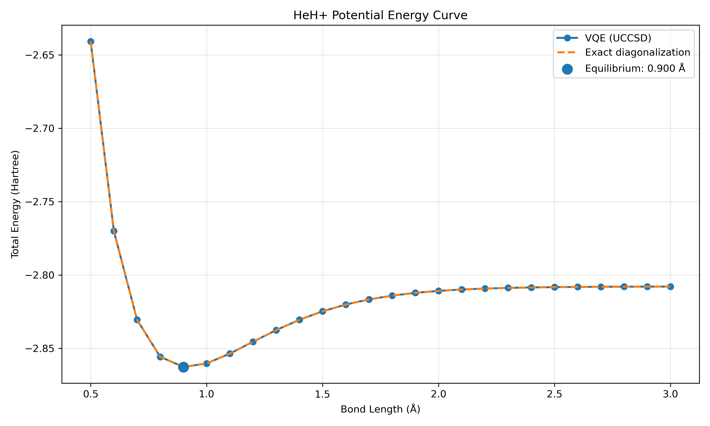

# HeH+ Potential Energy Surface with VQE

This project solves the Qiskit Fall Fest 2026 quantum chemistry side challenge:

> Plot the potential energy surface of the HeH+ molecule and defend the choice of basis set, fermion-to-qubit mapping, ansatz, and optimizer.

The notebook calculates the ground-state energy of HeH+ over bond lengths from 0.5 to 3.0 angstrom using the Variational Quantum Eigensolver (VQE). Exact diagonalization provides a reference at every geometry. Configuration benchmarks support **Parity mapping, UCCSD, and SLSQP** as the final VQE configuration.



## Results

| Quantity | Result |
| --- | ---: |
| Bond-length range | 0.5 to 3.0 angstrom |
| Number of geometries | 26 |
| Grid minimum | 0.90 angstrom |
| Minimum VQE energy | -2.86261758 Hartree |
| Largest VQE error | 5.42e-7 Hartree |
| Energy at 3.0 angstrom | -2.80783461 Hartree |
| Approximate binding gap to 3.0 angstrom | 0.05478297 Hartree, about 1.49 eV |

The VQE and exact curves overlap at the plotted scale. The reported equilibrium distance is the minimum on a grid with 0.1 angstrom spacing, not a fully optimized molecular geometry.

### Configuration benchmark at 0.8 angstrom

| Mapping | Ansatz | Optimizer | Qubits | Two-qubit gates | Absolute error (Hartree) | Observed runtime (s) |
| --- | --- | --- | ---: | ---: | ---: | ---: |
| Jordan-Wigner | UCCSD | SLSQP | 4 | 56 | 2.44e-8 | 0.098 |
| Jordan-Wigner | UCCSD | COBYLA | 4 | 56 | 1.02e-8 | 0.289 |
| Jordan-Wigner | UCCSD | L-BFGS-B | 4 | 56 | 7.38e-12 | 0.131 |
| Jordan-Wigner | RealAmplitudes | SLSQP | 4 | 6 | 1.60 | 0.041 |
| Jordan-Wigner | RealAmplitudes | COBYLA | 4 | 6 | 0.181 | 0.220 |
| **Parity** | **UCCSD** | **SLSQP** | **2** | **4** | **2.44e-8** | **0.046** |

The runtime values are single simulator measurements and should not be treated as hardware benchmarks. The gate counts come from logical circuit decomposition rather than compilation for a specific IBM processor.

## Method

For each bond length, the notebook:

1. Defines HeH+ with two electrons using `charge=1` and `spin=0`.
2. Uses PySCF to generate one-electron and two-electron integrals.
3. Uses parity mapping with particle-number reduction to obtain a two-qubit Hamiltonian.
4. Uses VQE to minimize the electronic energy.
5. Adds the nuclear repulsion energy to obtain the total molecular energy.
6. Compares the result with exact diagonalization.
7. Reuses the optimized parameters as the initial point for the next bond length.

## Choice of basis set: STO-3G

STO-3G is a minimal basis set. In this calculation it produces two spatial orbitals, or four spin orbitals. Parity mapping then uses the known particle numbers to reduce the model from four qubits to two.

This basis was chosen because the challenge focuses on demonstrating the quantum chemistry workflow and explaining the algorithmic choices. STO-3G keeps every geometry fast enough to scan and benchmark during a hackathon while still producing the expected bound-state minimum and dissociation trend.

The tradeoff is limited quantitative accuracy. A larger basis such as 6-31G would describe the electronic wavefunction more accurately but would increase the orbital count, qubit count, circuit size, and optimization cost. Therefore, the equilibrium distance and binding energy reported here should be interpreted as STO-3G model results rather than high-accuracy experimental predictions.

## Choice of mapping: Parity

Parity mapping stores occupation information through orbital parities. When Qiskit Nature receives the known particle numbers `(1, 1)`, it can remove two qubits associated with fixed symmetries. This reduces the HeH+ Hamiltonian from four qubits under Jordan-Wigner to two qubits under parity mapping.

The benchmark supports parity mapping as the final choice. With UCCSD and SLSQP fixed, parity mapping reduced the measured two-qubit gate count from 56 to 4 while preserving the energy error at approximately 2.44e-8 Hartree. It also reduced the observed statevector runtime from 0.098 seconds to 0.046 seconds in that single test.

Jordan-Wigner remains a useful baseline because it gives each spin orbital a direct qubit interpretation and requires no qubit reduction. However, the challenge asks for a justified implementation choice, and parity provides the same numerical accuracy with substantially lower circuit resources for this problem. That resource reduction is more valuable for eventual hardware execution.

## Choice of ansatz: Hartree-Fock plus UCCSD

The circuit starts from the Hartree-Fock state and applies the unitary coupled-cluster singles and doubles ansatz, UCCSD. For this two-electron, two-spatial-orbital problem, the ansatz contains only three parameters.

UCCSD was chosen because it is based on electronic excitations rather than a generic hardware-efficient circuit. It preserves the chemistry structure of the problem and provides a clear connection to established coupled-cluster methods. Starting from Hartree-Fock with all variational parameters set to zero gives the optimizer a physically meaningful initial state.

The results support this choice. UCCSD reproduces the exact diagonalization curve with a maximum observed error of approximately 5.42e-7 Hartree across the bond scan. At 0.8 angstrom, the parity/UCCSD/SLSQP configuration had an error of 2.44e-8 Hartree. By comparison, the tested RealAmplitudes circuits had errors of 0.181 to 1.60 Hartree despite using fewer gates. This shows that a short generic circuit is not useful when it cannot represent the target chemical state accurately.

The tradeoff is that UCCSD circuits become deep and expensive as the number of orbitals grows. That limitation is small for HeH+ but important for larger molecules and noisy hardware.

## Choice of optimizer: SLSQP

SLSQP is a deterministic, gradient-based classical optimizer. It was chosen because `StatevectorEstimator` provides a smooth, noiseless objective function and the UCCSD circuit has only three parameters. At 0.8 angstrom, parity/UCCSD/SLSQP achieved an error of 2.44e-8 Hartree in 0.046 seconds in the recorded run.

L-BFGS-B produced the smallest single-point error in the comparison, but SLSQP was faster and its error was already far below the commonly used chemical-accuracy scale of about 1.6e-3 Hartree. COBYLA also reached an accurate result with UCCSD but took longer in the recorded run. SLSQP therefore provides the strongest accuracy-to-cost balance for this noiseless, low-dimensional problem.

The potential-energy scan also uses a warm start: the optimal parameters from one bond length initialize the next calculation. Neighboring molecular geometries have similar ground states, so this reduces repeated optimization work and helps maintain a smooth curve.

SLSQP is less suitable for noisy quantum-hardware measurements because shot noise can make numerical gradients unreliable. SPSA or another noise-tolerant optimizer would be a stronger choice for a hardware experiment. This project uses SLSQP because its goal is to evaluate the chemistry and ansatz accuracy on a noiseless simulator.

## Validation

Every VQE result is compared with `NumPyMinimumEigensolver` using the molecular problem's particle-number filter. The total energy from the exact solver already includes nuclear repulsion. For the direct VQE calculation, the notebook adds nuclear repulsion to the electronic eigenvalue explicitly before comparing the two methods.

The close agreement confirms that the optimizer converged and that the selected UCCSD ansatz represents the ground state accurately within the STO-3G model. The configuration comparison changes one or more VQE components and records qubits, logical two-qubit gates, optimizer evaluations, runtime, and error. The full-curve comparison also confirms that parity and Jordan-Wigner produce the same potential-energy surface within numerical precision.

These results do not demonstrate quantum advantage because both algorithms run on a classical computer and the molecular model is intentionally small.

## Repository contents

- `QuantumChemistry.ipynb`: complete calculation and analysis
- `HeH_PES.png`: potential-energy curve
- `HeH_PES_results.csv`: numerical data for all geometries
- `requirements.txt`: Python dependencies

## Run the notebook

Create and activate a virtual environment, then install the dependencies:

```bash
python3 -m venv .venv
source .venv/bin/activate
python -m pip install --upgrade pip
python -m pip install -r requirements.txt
```

Start Jupyter and run the cells in `QuantumChemistry.ipynb` from top to bottom:

```bash
jupyter lab
```

The scan writes `HeH_PES_results.csv` and `HeH_PES.png` to the current working directory.

## Possible extensions

- Refine the grid near the minimum to improve the equilibrium-distance estimate.
- Compare STO-3G with 6-31G while holding the mapping, ansatz, and optimizer fixed.
- Transpile every ansatz to the same hardware gate set before comparing circuit depth and two-qubit gates.
- Repeat selected geometries with a shot-based or noisy estimator.
- Test SPSA and error-mitigation methods for hardware execution.

## References

- [Qiskit Nature getting started](https://qiskit-community.github.io/qiskit-nature/getting_started.html)
- [Qiskit Nature VQE with a UCC ansatz](https://qiskit-community.github.io/qiskit-nature/howtos/vqe_ucc.html)
- [Qiskit Nature ground-state solvers](https://qiskit-community.github.io/qiskit-nature/tutorials/03_ground_state_solvers.html)
